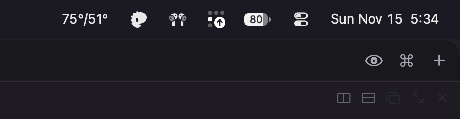

# TempBar

A tiny macOS menu bar app that shows the inside and outside temperature as `inside°/outside°`.



Click it to see the rest:

- **Inside** — temperature, humidity, thermostat mode/target, and air quality, from [Home Assistant](https://www.home-assistant.io).
- **Outside** — temperature, feels-like, conditions, humidity, wind, US AQI and PM2.5, from [Open-Meteo](https://open-meteo.com) at your current location.

## How it stays current

- **Inside:** a WebSocket to Home Assistant, so changes show up the moment HA reports them. Reconnects with backoff after sleep or network changes.
- **Outside:** Open-Meteo's free forecast and air-quality APIs (no key). Refreshes every 10 minutes, after a ~1 km move, and on wake.

Using Apple Home? Expose your devices to Home Assistant (e.g. via the HomeKit Controller or Matter integrations) and point TempBar at those entities. macOS has no public HomeKit API for menu bar apps.

## Requirements

- macOS 15+
- Xcode 16+ (Swift 6)
- A Home Assistant instance reachable from your Mac

## Build

```sh
./scripts/build-app.sh            # -> build/TempBar.app
./scripts/build-app.sh --install  # copy to ~/Applications and launch
swift test                        # unit tests
TEMPBAR_LIVE=https://your-ha-host swift test   # + live Open-Meteo and HA handshake checks
```

The build script signs with your Apple Development identity if you have one (so Keychain access survives rebuilds), and falls back to ad-hoc signing.

## Setup

On first launch the Settings window opens. Enter:

1. Your Home Assistant URL.
2. A long-lived access token (Home Assistant › Profile › Security). Tip: create it under a dedicated non-admin user so you can revoke it independently.
3. Entity IDs for indoor temperature, humidity, the thermostat (`climate.*`), and optionally an air-quality sensor.

The token is stored in your Keychain. Everything else is in `defaults read com.ankitsachdeva.tempbar`. Nothing personal is compiled into the app.

## License

MIT
